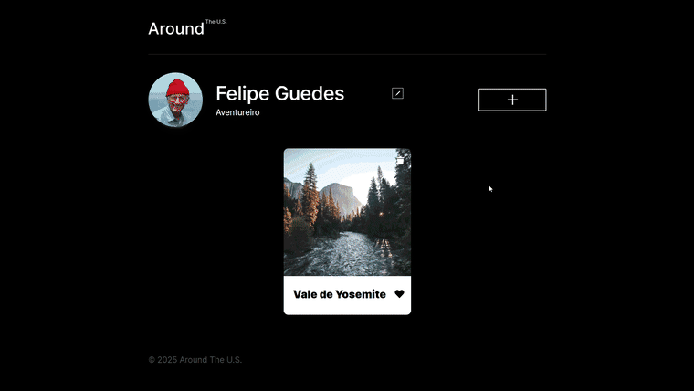

# Around The U.S.

Galeria interativa onde o usuário publica fotos de lugares dos Estados Unidos, com perfil editável e tudo salvo num servidor via API.

Demo ao vivo: [felipeguedds.github.io/web_project_around_pt](https://felipeguedds.github.io/web_project_around_pt/)

É o projeto principal do bootcamp da Tripleten, construído em etapas, e cada etapa adiciona funcionalidades novas. Nesta etapa o site passou a conversar com um servidor. Perfil, avatar, cartões e curtidas agora são carregados e salvos via API.

## Funcionalidades

O usuário edita nome, bio e foto de perfil pelos popups, e tudo é salvo no servidor. A galeria de cartões é carregada da API ao abrir a página. Dá pra adicionar um lugar novo, curtir (as curtidas ficam salvas) e excluir, sendo que a lixeira só aparece nos cartões do próprio usuário e a exclusão passa por um popup de confirmação. Clicar no cartão abre a imagem ampliada.

Os formulários são validados em tempo real: o campo mostra o erro em vermelho e o botão de envio fica bloqueado enquanto houver dado inválido. Durante as requisições os botões mostram "Salvando..." pra dar retorno de que algo está acontecendo. Os popups fecham pelo X, clicando fora da janela ou apertando Esc.

## Construído com

- HTML e CSS, com o CSS organizado em BEM flat
- JavaScript orientado a objetos: o código é dividido em classes com responsabilidade única (`Api`, `Card`, `FormValidator`, `Section`, `UserInfo` e a família `Popup` com `PopupWithImage`, `PopupWithForm` e `PopupWithConfirmation`), conectadas por `import`/`export`
- JavaScript assíncrono com a Fetch API: requisições na classe `Api`, resposta verificada antes do `.json()`, erros tratados no `.catch` e `Promise.all` pra carregar usuário e cartões juntos antes de renderizar
